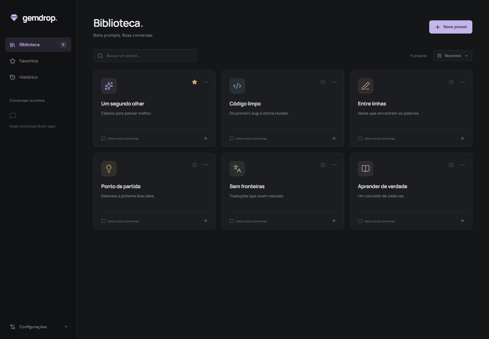

# Gemdrop

Sua biblioteca de system prompts, com um chat para cada ideia.

App desktop em Tauri 2, React e TypeScript. Interface escura, presets com ícones e cores, histórico local e respostas por streaming via OpenRouter.



## Usar

Baixe o instalador ou a versão portátil em [Releases](https://github.com/MusicMaster4/gemdrop/releases). O [beta mais recente](https://github.com/MusicMaster4/gemdrop/releases/tag/channel-testing) tem links permanentes:

- [Instalador Windows x64](https://github.com/MusicMaster4/gemdrop/releases/download/channel-testing/Gemdrop-beta-setup.exe)
- [ZIP portátil Windows x64](https://github.com/MusicMaster4/gemdrop/releases/download/channel-testing/Gemdrop-beta-portable.zip)

Abra as configurações, adicione sua chave do OpenRouter e escolha um modelo. Crie um preset com título, descrição e system prompt; abra o preset para começar uma conversa. Cada conversa preserva o prompt usado na criação, mesmo que você edite o preset depois.

Em Configurações, defina o modelo e o **thinking effort** padrão. Cada preset pode herdar esses valores ou escolher os seus. Novas conversas preservam o modelo e o esforço resolvidos na criação; conversas antigas mantêm sua configuração. Automático usa o padrão do provedor, e a disponibilidade dos demais níveis depende do modelo.

O app inicial é distribuído para Windows x64 e usa o WebView2 do sistema. O pacote portátil pode ser extraído e executado sem instalar o Gemdrop.

## Desenvolver localmente

Pré-requisitos: [Bun](https://bun.sh), [Rust estável](https://rustup.rs), Microsoft C++ Build Tools com **Desktop development with C++** e WebView2 Runtime. Veja os [requisitos do Tauri para Windows](https://v2.tauri.app/start/prerequisites/#windows).

```sh
bun install
bun run app
```

`bun run app` abre o aplicativo desktop diretamente. A primeira execução compila o backend Rust; as próximas reutilizam o cache. O launcher `Iniciar-Gemdrop.bat` também inicia o app a partir desta pasta.

Para trabalhar apenas na interface:

```sh
bun run dev
```

Abra `http://127.0.0.1:1427`, ou execute `Preview-Chrome.bat` para iniciar o servidor e abrir uma nova aba no Chrome. O navegador permite testar a interface e a biblioteca; as credenciais e o chat com OpenRouter são recursos do app desktop.

## Verificar e compilar

```sh
bun run check
bun run test
node --test scripts/release-version.test.mjs scripts/release-manifest.test.mjs scripts/release-apply-version.test.mjs
cargo test --locked --manifest-path src-tauri/Cargo.toml
bun run build
```

O build nativo de distribuição usa `bun run desktop:build --bundles nsis` e requer a chave privada de assinatura do updater nas variáveis `TAURI_SIGNING_PRIVATE_KEY` e `TAURI_SIGNING_PRIVATE_KEY_PASSWORD`. Para gerar um instalador local sem a assinatura de atualização, crie um arquivo `unsigned.json` com `{"bundle":{"createUpdaterArtifacts":false}}` e execute:

```sh
bun run desktop:build --bundles nsis --config unsigned.json
```

Não inclua chaves privadas ou dados pessoais no Git.

## Dados e conexões

Presets, configurações e conversas ficam no armazenamento local do app. A chave da API fica no gerenciador de credenciais do sistema, separada dos dados exportados. O Gemdrop não tem servidor próprio nem exige uma conta do aplicativo.

Ao enviar uma mensagem, o app transmite ao OpenRouter o system prompt da conversa, seu histórico e a nova mensagem. O catálogo de modelos vem do OpenRouter. A verificação de atualização consulta as releases públicas do GitHub. Os preços, a disponibilidade e as políticas dos modelos são definidos pelo OpenRouter e pelos provedores escolhidos.

## Branches e releases

- `main` publica uma versão estável e atualiza somente o canal estável.
- `testing` publica um beta e atualiza somente o canal beta.
- As outras branches e os pull requests executam CI, sem publicar releases.

Os canais usam endpoints de atualização separados. Um push em `testing` não altera `main` nem a versão estável; um push em `main` não promove nem mescla a branch `testing`.

Cada release só é publicada depois dos testes e do build nativo. O workflow anexa instalador, ZIP portátil, assinatura do updater, manifesto e checksums SHA-256. Betas são marcados como prerelease e nunca como Latest. O workflow também pode ser executado manualmente, com opção de apenas compilar.

Veja [docs/releases.md](docs/releases.md) para a configuração de assinatura e o versionamento.

## Licença

[MIT](LICENSE)
